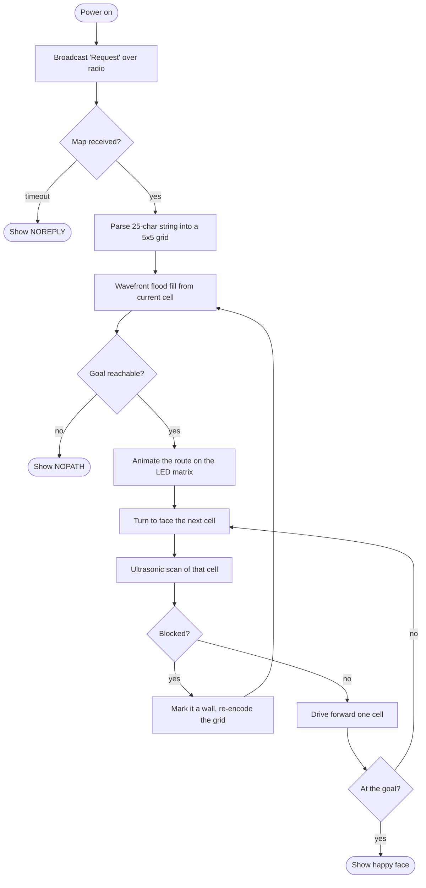

# micro:bit Maze Robot

[](https://github.com/Sriram-Gutta/microbit-maze-robot/actions/workflows/tests.yml)


An autonomous robot car, built on a BBC micro:bit, that solves a 5×5 grid maze
and drives itself through it. It receives the course map over radio, computes
the shortest route with a wavefront (breadth-first) search, converts that route
into physical motion, and re-plans on the fly when its ultrasonic sensor finds
an obstacle that was never on the map.

**The firmware runs on your laptop.** `sim/` puts stub `microbit`, `machine` and
`radio` modules on the import path and drives the *real* `src/main.py` against a
simulated world — no hardware required. That is how the obstacle-avoidance bug
below was diagnosed and verified fixed.

This was a 3-person course project (Mar–Apr 2026). The robot described here,
including its drive calibration, is the team's shared work. The simulator, test
suite and the root-cause analysis of the stage 2 failure are my own follow-up
work (Jul 2026).

---

## Try it in 10 seconds

```console
$ git clone https://github.com/Sriram-Gutta/microbit-maze-robot
$ cd microbit-maze-robot
$ python3 sim/simulate.py
```

No dependencies — standard library only, Python 3.9+.

The robot is given a map with two equally short routes, then dropped into a
world containing an obstacle that isn't on that map:

```
  move 1 -> DOWN
  WORLD         ROBOT'S MAP   LED
  . . . . .     . . . . .     . . . . .
  v O . . .     R . . . .     * . . . .
  # . # . #     # . # . #     + . + . +
  . . . . .     . . . . .     . . . . .
  . . . . X     . . . . X     . . . . %
  sensor: 40 mm toward RIGHT (cell (1, 1))

  move 2 -> UP
  WORLD         ROBOT'S MAP   LED
  ^ . . . .     R . . . .     * . . . .
  . O . . .     . # . . .     . + . . .
  # . # . #     # . # . #     + . + . +
  . . . . .     . . . . .     . . . . .
  . . . . X     . . . . X     . . . . %
```

`WORLD` is ground truth — `O` is the hidden obstacle, `^ > v <` the robot and
its heading. `ROBOT'S MAP` is what the firmware currently believes. Watch the
obstacle appear as `#` on the robot's map the moment the sensor sees it, then
watch the route change.

## How it works



**Wavefront search.** Flood outward from the current cell, labelling each
reachable cell with its distance, then walk backward from the goal, always
stepping to a neighbour labelled one lower. That yields a shortest path, and
the distance field makes re-planning cheap.

**Re-planning through the map string.** When the sensor finds an obstacle, the
grid is re-encoded back into a 25-character map string — the robot's current
cell becomes the new `S`, the obstacle becomes a `1` — and that string is parsed
by the same function that handles radio input. It is not the most direct way to
mutate a grid, but it means the re-planning path and the radio path converge on
identical parsing code: one code path, exercised twice.

A map like `S00000000010101000000000X` decodes to:

```
S . . . .        S  start cell
. . . . .        X  goal cell
# . # . #        #  wall
. . . . .        .  open
. . . . X
```

## The interesting bug

In the live demonstration, stage 2 failed: the robot **detected** the obstacle —
it appeared correctly on the LED map — but drove into it anyway.

Rebuilding the run in the simulator reproduced it exactly and showed the cause.
The scan happened *after* each move completed, so by the time an obstacle was
seen, the robot had already committed to entering its cell. Worse, once its
believed position had drifted from its real one, the reading got attributed to
the wrong grid cell entirely — so it marked a wall it had never seen and left
the real obstacle unmapped.

The fix is to scan after turning but *before* driving, which gives the planner
an actual interruption point. Both behaviours ship, selected by
`SCAN_BEFORE_MOVE` in [src/main.py](src/main.py):

```console
$ python3 sim/simulate.py --compare

                         scan AFTER move      scan BEFORE move
                       (as demonstrated)     (current default)
  ------------------------------------------------------------
  reached goal                        no                   yes
  collisions                           3                     0
  moves                                8                    10
  turns                                8                     9
  sensor reads                         3                     5
```

Two extra moves is the detour around the obstacle. The demonstrated behaviour is
kept, and covered by a regression test, so the original failure stays
reproducible rather than becoming a story with no evidence behind it.

## Tests

```console
$ python3 -m unittest discover -s tests -v
...
Ran 25 tests in 0.002s

OK
```

Covering map parsing and its error cases, the sector round-trip, wavefront
optimality and path contiguity, unreachable goals, heading arithmetic, and
end-to-end missions with and without an unmapped obstacle.

## Repository layout

```
src/main.py                 Robot firmware — the full stage 1 + stage 2 program
src/robotbit_library.py     PCA9685 motor/servo driver for the Robotbit board
sim/simulate.py             Desktop simulator and CLI
sim/harness.py              Imports the MicroPython firmware under CPython
sim/stubs/                  Stand-ins for microbit, machine, radio, robotbit
tools/ultrasonic_test.py    Bench test that streams live distance readings
tests/test_wavefront.py     Unit and end-to-end tests
docs/design-notes.md        Design decisions, calibration, results, limitations
```

## Hardware

- BBC micro:bit (MicroPython)
- Robotbit expansion board — motor driver and power distribution
- Two DC gear motors driving the rear wheels
- HC-SR04-style ultrasonic sensor, fixed forward-facing on the chassis
- Rechargeable battery pack

The sensor is mounted rigidly rather than on a servo. Because the robot always
turns to face a cell before entering it, a fixed forward-facing sensor sees
everything the navigation logic actually needs — which removed a moving part and
a whole class of calibration work.

## Running on the real robot

1. Copy `src/robotbit_library.py` onto the micro:bit filesystem (the Mu editor's
   *Files* pane, or `ufs put`). `main.py` imports it and will not run without it.
2. Flash `src/main.py` to the micro:bit.
3. Set `RADIO_CHANNEL` to match the channel the map transmitter broadcasts on.
4. Place the robot on the start cell **facing "up"** relative to the grid — the
   heading tracker assumes this starting orientation.
5. Power on. The display shows `R` while waiting for a map, sweeps a pixel across
   the middle row as a progress indicator, then animates the solved route before
   driving.

### Calibration

Two timing constants control all motion, and both are specific to a given
chassis and battery charge:

| Constant | Value | Meaning |
|---|---|---|
| `CELL_TIME_MS` | 856 | ms at 50% power to travel one cell (10 in) |
| `TURN_TIME_MS` | 368 | ms at 50% power for a 90° rotation |
| `BLOCK_MM` | 50 | distance at which the cell ahead counts as blocked |

These were measured with the robot on a charging cable so the motors ran at full
torque. Expect to re-measure for any other build — and note that a partly charged
battery changes them, which caused real problems here.
[docs/design-notes.md](docs/design-notes.md) covers the calibration method, the
power issues, the full results, and the remaining limitations.

## License

MIT — see [LICENSE](LICENSE). `src/robotbit_library.py` is a course-provided
driver, included unmodified.
